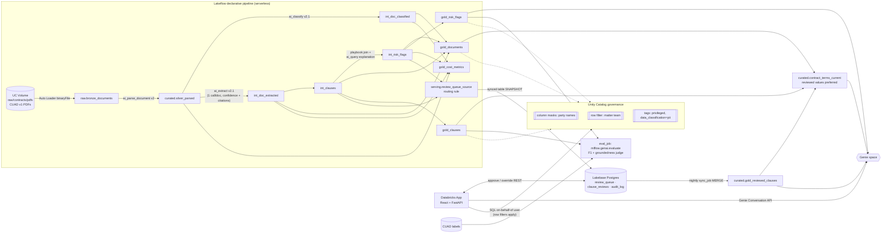

# Matter Intelligence — Legal Document Intelligence on Databricks

Corporate legal teams miss auto-renewal deadlines and can't see uncapped-liability exposure across hundreds
of vendor contracts. **Matter Intelligence** is an end-to-end demo for the fictional customer
**Northwind Legal Cloud**. It works like this:

1. Public contracts are ingested and turned into structured clause data with Databricks AI Functions.
2. That data is governed in Unity Catalog.
3. Low-confidence or risky clauses go to a human review workflow that runs on Lakebase.
4. Reviewers use a Databricks App, and anyone can ask questions in plain English through Genie.

Everything deploys with one Databricks Asset Bundle.

The build follows [`spec.md`](spec.md). Every claim below links to text evidence regenerated from the live
workspace by [`scripts/export_evidence.py`](scripts/export_evidence.py).

## Architecture



## Results (final run, 100 CUAD contracts)

| Area | Result | Evidence |
|---|---|---|
| Pipeline | 100/100 docs bronze→gold, 775 clauses, 293 risk flags (62 high); **all 4 expectations 0 failures**; idempotent rerun adds 0 rows | [02_pipeline_run.md](evidence/02_pipeline_run.md), [03_sample_outputs.md](evidence/03_sample_outputs.md) |
| Governance | Same SELECT as admin vs restricted user: **100 → 48 documents, 775 → 369 clauses, 293 → 141 flags**; parties shown as `Party ***`; row filter on all 4 gold tables | [01_uc_governance.md](evidence/01_uc_governance.md) |
| Extraction quality (vs CUAD expert labels) | **Micro F1 0.827** (P 0.847 / R 0.809) · **key-clause F1 0.764** · governing law 0.94, assignment 0.94, parties 1.00; weakest: uncapped liability 0.52, auto-renewal 0.62 (proxy label) | [04_eval_results.md](evidence/04_eval_results.md), [eval_results.json](evidence/eval_results.json), [notebook](notebooks/03_eval.ipynb) |
| Explanation groundedness (LLM judge) | **0.91** over 136 high/medium explanations (0.63 before the prompt fix) | [04_eval_results.md](evidence/04_eval_results.md) |
| Cost | **≈ $109 per 1K docs** (estimate; parsing dominates) | [02_pipeline_run.md](evidence/02_pipeline_run.md) |
| Review workflow | 86.5% of clauses auto-accepted by the routing rule; override goes from the app to Lakebase to Delta; **review action p95 18.8 ms** (target 300 ms) | [05_lakebase_roundtrip.md](evidence/05_lakebase_roundtrip.md), [notebook](notebooks/04_lakebase_roundtrip.ipynb) |
| App | React + FastAPI app running; reviewer actions recorded in `audit_log` | [07_app.md](evidence/07_app.md) |
| Genie | **7/7 questions match hand-written SQL**; "auto-renew in 90 days with uncapped liability" goes from 1 contract to 0 after the Lakebase override | [06_genie_transcript.md](evidence/06_genie_transcript.md), [notebook](notebooks/05_genie_validation.ipynb) |
| ROI (illustrative) | 3,083 reviewer hours/yr saved, ≈ $1.45M net value/yr, payback < 1 month for a 5,000-contract portfolio | [roi_model.md](evidence/roi_model.md), [notebook](notebooks/06_roi_model.ipynb) |
| Run log | Timestamped console output of every `bundle validate / deploy / run` | [run_log.txt](evidence/run_log.txt) |

## Repository layout

```
databricks.yml            bundle (targets dev, demo); variables catalog, schema, warehouse_id,
                          lakebase_instance, genie_space_id, doc_limit, explain_model
resources/                pipeline.yml, jobs.yml (setup, eval, lakebase, sync, roundtrip, override demo),
                          app.yml, lakebase.yml (database instance)
src/setup/                CUAD download, synthetic overlay (Faker, seed 42), UC governance SQL + runner
src/pipeline/             bronze → silver → gold SQL (AI Functions), cost metrics, serving review queue
src/eval/                 CUAD ground truth mapping, mlflow.genai evaluation
src/lakebase/             Postgres schema, synced table setup, review sync-back, scripted round trip
src/genie/                views.sql, instructions.md, example_queries.sql, create_space.py, validate.py
src/app/                  FastAPI backend (main.py, lakebase.py, genie_client.py) + built React UI (static/)
frontend/                 React + Vite + Tailwind source for the app UI (npm run build → src/app/static)
notebooks/                01–06, committed WITH outputs (executed against the live workspace)
scripts/                  export_evidence.py, build_notebooks.py, roi_model.py, bundle_log.sh, dbx.py
evidence/                 text execution evidence
tests/                    unit tests for pure-Python helpers
```

## Setup

Prerequisites:
- Databricks CLI ≥ 0.299, authenticated with a profile.
- A workspace with serverless compute, AI Functions, Lakebase and Databricks Apps.
- Python 3.11. Node ≥ 20 is only needed to rebuild the UI.

```bash
python3.11 -m venv .venv && .venv/bin/pip install databricks-sdk "mlflow[databricks]>=3.5" rapidfuzz \
    pandas tabulate nbformat nbclient ipykernel
export DATABRICKS_CONFIG_PROFILE=<profile>        # edit targets.dev in databricks.yml (host, catalog, warehouse)

scripts/bundle_log.sh "validate" validate
scripts/bundle_log.sh "deploy"   deploy           # pipeline, jobs, Lakebase instance, app
scripts/bundle_log.sh "setup"    run setup_job    # stage CUAD, synthetic data, governance, pipeline
scripts/bundle_log.sh "eval"     run eval_job     # CUAD eval + groundedness judge → MLflow
scripts/bundle_log.sh "app"      run matter_app   # start the app (creates its service principal)
scripts/bundle_log.sh "lakebase" run lakebase_job # synced table, review queue, grants to the app SP
.venv/bin/python src/genie/create_space.py --catalog <catalog> --warehouse_id <id>
#   → set targets.<t>.variables.genie_space_id, then: bundle deploy && bundle run matter_app
.venv/bin/python src/genie/validate.py --catalog <catalog> --warehouse_id <id> --space_id <id> --tag before
scripts/bundle_log.sh "override" run override_demo_job
.venv/bin/python src/genie/validate.py ... --tag after --only 1
.venv/bin/python scripts/export_evidence.py --phase 1 2 3 4
.venv/bin/python scripts/build_notebooks.py 01 02 03 04 05 06
```

Develop with `doc_limit: 20`. The final run uses 100.

To rebuild the UI: `cd frontend && npm install && npm run build`.

**Cost and cleanup:** the Lakebase instance (CU_1) and the app's compute run until you stop them. Use
`databricks apps stop matter-intel-reviewer` and `databricks bundle destroy` when you're done.

## Demo script

1. **Pipeline pick-up.** Drop 10 new PDFs into `/Volumes/<catalog>/raw/contracts/pdfs/` (or raise
   `doc_limit` and run `setup_job`). The pipeline's Auto Loader ingests only the new files, and the gold
   tables and cost metrics update.
2. **Governance.** In Catalog Explorer, follow lineage from a PDF in the Volume through `bronze_documents`,
   `silver_parsed` and `int_clauses` to `gold_clauses`. Then show the masked view as a restricted user:
   party names appear as `Party ***` and only the user's matter teams are visible
   ([01_uc_governance.md](evidence/01_uc_governance.md)).
3. **Eval.** Show per-clause F1, groundedness and cost per 1K docs in the MLflow experiment
   `matter-intelligence-eval` ([04_eval_results.md](evidence/04_eval_results.md)).
4. **App.** Open *Documents*, pick a high-risk contract (red stripe), read the AI risk explanation next to its
   highlighted source text, and **Override** a liability term with a comment. A toast shows the Lakebase save
   time.
5. **Genie.** Ask *"Which contracts auto-renew in the next 90 days with uncapped liability?"* in *Ask Genie*.
   After `sync_job` runs, the answer reflects the override: the overridden license drops out
   ([06_genie_transcript.md](evidence/06_genie_transcript.md)).

## Trade-offs and deviations from the spec

These are deliberate, and each is recorded in the evidence.

- **Catalog:** the workspace user can't `CREATE CATALOG` on the shared metastore. The dev target therefore
  sets `catalog` to the workspace catalog, while the bundle default stays `matter_intel`. For the same reason,
  Lakebase isn't registered as a UC catalog. The synced table lives in `<catalog>.serving`, and
  `sync_reviews_back.py` mirrors the Postgres tables into Delta (`serving.pg_*`) for analytics and evidence.
- **Groups:** `legal_admins`, `legal_reviewers` and `legal_reviewers_full` could only be created as
  workspace-local groups. `is_member()` evaluates them inside the masks and row filter, but UC `GRANT` to them
  is rejected. That rejection is logged in `curated.governance_log` and doesn't fail the job. Grants to the
  app's service principal, an account-level principal, succeed.
- **Restricted test user:** this is the same identity, removed from the admin and full-access groups through
  SCIM and restored afterwards. That avoided minting credentials for a separate test principal.
- **`pii` tag:** `pii` is an account-governed tag whose only allowed values are `ssn` and `address`. The
  columns are tagged `data_classification = 'pii'` instead, and the rejected attempt is logged.
- **Intermediate tables:** the AI calls run once per document in streaming `int_*` tables, and the masked,
  row-filtered `gold_*` views read from them. The `int_*` tables themselves aren't filtered; production would
  restrict them to the pipeline owner.
- **Streamlit → React + FastAPI:** chosen for a polished reviewer UX. It also makes approve and override real
  REST POSTs. SQL still runs on behalf of the signed-in user, so UC filters apply.
- **`contract_terms_current` and `next_renewal_date`:** CUAD contracts are historical SEC filings, so their
  initial terms ended years ago. For evergreen contracts the view rolls the term forward by the renewal term
  (default 12 months) to the next renewal on or after today. The view also prefers reviewed values over
  extracted ones, which is what makes Genie reflect overrides without a pipeline refresh.
- **Cost:** AI Functions don't return token usage, so tokens are estimated as characters ÷ 4 and unit prices
  are illustrative configuration values. Parsing dominates, at an assumed $0.005 per page. Check against your
  rate card or `system.billing.usage`.
- **Eval caveats:**
  - CUAD has no auto-renewal label, so the presence of a *Renewal Term* span is used as a proxy.
  - `indemnification` has no CUAD category and isn't evaluated.
  - Two extraction field descriptions and the explanation prompt were refined after inspecting the first 20
    documents, which are part of the 100-document eval set.
  - Only one extraction model was evaluated; comparing a second model was a STRETCH item and was skipped.
- **Genie demo reset:** in the final run, the demo override first ran before the "before" validation (a shell
  quoting error). It was reset with a recorded reviewer override (`true`), then before → override → after ran
  in order. All three review records are kept, and the sequence is noted in `run_log.txt`.
- **Real company names:** CUAD contracts are public SEC filings that name real companies. As agreed with the
  repo owner, they appear in the evidence as-is. No customer data is used, and the matters, users and playbook
  are synthetic.
- **STRETCH items skipped:** the agent-framework explanation agent and the second-model comparison.

## Dataset credit

**CUAD v1 — Contract Understanding Atticus Dataset**, by The Atticus Project, is licensed under
[CC BY 4.0](https://creativecommons.org/licenses/by/4.0/) and available at https://zenodo.org/records/4595826.
It contains 510 commercial contracts with 41 expert-labeled clause categories. Citation: Hendrycks, Burns,
Chen and Ball, *"CUAD: An Expert-Annotated NLP Dataset for Legal Contract Review"*, NeurIPS 2021. This
project uses a deterministic 100-contract subset (`src/setup/00_download_cuad.py`) for ingestion and the
`master_clauses.csv` labels as evaluation ground truth. The synthetic overlay (matters, users and playbook) is
generated with Faker and is fictional.
